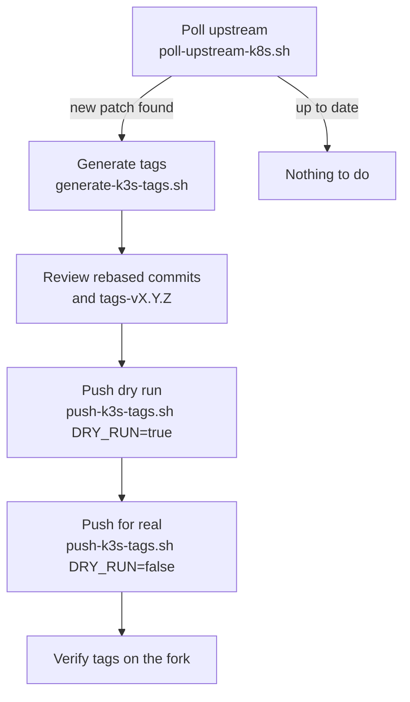

# Manual k8s tag sync

How to run the k3s tag sync from your own machine, without GitHub Actions.

Use this when:

- the workflow is unavailable or failing and a release can't wait
- you need to debug a single step (rebase, `tag.sh`, push)
- you want to sync a version the poller skips (see [Limitations](#limitations))

The local run uses the same scripts as the workflows in `.github/scripts/`:

| Script | Purpose |
| --- | --- |
| `poll-upstream-k8s.sh` | Lists the minors where upstream has a release the fork doesn't |
| `generate-k3s-tags.sh` | Rebases the k3s carry commits and runs `tag.sh` to create the tags locally |
| `push-k3s-tags.sh` | Pushes the generated tags to the fork |
| `lib-k3s-tags.sh` | Shared helpers, sourced by the others |



## Prerequisites

- Linux, or macOS with Docker Desktop. The scripts are tested on Linux (GitHub runners); macOS should work but is not verified.
- `bash`, `git`, `docker`, `jq`, and `sort` with `-V` support
- Docker running and usable by your user (`docker info` works without `sudo`)
- About 10 GB free disk for the kubernetes clone, the Go build cache, and the image
- For the push step only: a GitHub token with write access to the target fork, including permission to push workflow files

> [!IMPORTANT]
> Use a dedicated clone of the fork for this, never your working copy.
> `generate-k3s-tags.sh` runs `git clean -xfd`, `git checkout .` and a rebase,
> sets `user.name`/`user.email` in the repo config, and `tag.sh` deletes any
> local tag pointing at `HEAD`. Anything uncommitted in that clone is lost.

## Steps

<details>
<summary>1. Clone the release tooling</summary>

```bash
git clone https://github.com/k3s-io/release.git
cd release

export RELEASE_DIR="$PWD"
```

</details>

<details>
<summary>2. Set the target fork</summary>

`k3s-io/kubernetes` is the production target. Point to a personal fork when testing.

```bash
export K8S_REPO="k3s-io/kubernetes"
export K3S_FORK_URL="https://github.com/${K8S_REPO}.git"
```

</details>

<details>
<summary>3. Check which versions need a sync</summary>

The poller writes its result to `$GITHUB_OUTPUT`. Point it to stdout to read it directly.

```bash
GITHUB_OUTPUT=/dev/stdout "${RELEASE_DIR}/.github/scripts/poll-upstream-k8s.sh"
```

Example output:

```
  v1.35: up to date (upstream v1.35.9, fork v1.35.9)
  v1.36: NEW upstream v1.36.6 (fork at v1.36.5)
matrix=[{"new_k8s_version":"v1.36.6","old_k8s_version":"v1.36.5"}]
count=1
found 1 minor(s) needing sync
```

Each matrix entry is one sync. Run steps 4 to 9 once per entry, using its `new_k8s_version` and `old_k8s_version`.

</details>

<details>
<summary>4. Clone the fork into a dedicated directory</summary>

Clone over HTTPS. The push script authenticates with a token header, which only applies to HTTPS remotes.

```bash
export WORKSPACE="${HOME}/k3s-sync/kubernetes"

git clone "https://github.com/${K8S_REPO}.git" "${WORKSPACE}"
```

This is a large clone (all branches and tags). Reuse it for later syncs instead of cloning again; step 10 shows how to reset it.

</details>

<details>
<summary>5. Set the sync variables</summary>

```bash
export NEW_K8S_VERSION="v1.36.6"   # new_k8s_version from step 3
export OLD_K8S_VERSION="v1.36.5"   # old_k8s_version from step 3
export NEW_SUFFIX="k3s1"

export GIT_USER_NAME="Your Name"
export GIT_USER_EMAIL="you@example.com"

# Keep the container's GOPATH and Go cache outside the kubernetes clone.
export RUNNER_TEMP="${HOME}/k3s-sync/tmp"
mkdir -p "${RUNNER_TEMP}"
```

- `OLD_K8S_VERSION` can be left unset for a patch bump in the same minor. The script then uses the highest k3s-tagged patch in the fork, which is what the poller reports anyway.
- For a cross-minor rebase, `OLD_K8S_VERSION` must be set explicitly.
- `GIT_USER_NAME`/`GIT_USER_EMAIL` become the committer of the rebased commits and of the `tag.sh` version commit.
- `RUNNER_TEMP` is set by GitHub Actions on runners. Without it, the scripts fall back to `${WORKSPACE}/.tagger`, inside the clone.

</details>

<details>
<summary>6. Generate the tags</summary>

```bash
"${RELEASE_DIR}/.github/scripts/generate-k3s-tags.sh"
```

What it does:

1. Rejects anything that isn't `vX.Y.Z`, and `.0` releases
2. Fetches `NEW_K8S_VERSION` and `OLD_K8S_VERSION` from upstream kubernetes
3. Finds the latest k3s tag for `OLD_K8S_VERSION` (`-k3s1`, `-k3s2`, ...)
4. Rebases the k3s carry commits onto `NEW_K8S_VERSION`
5. Builds a Go image matching the `.go-version` of `NEW_K8S_VERSION`
6. Runs `tag.sh` in that image, which builds `./cmd/*`, commits the version files and creates the tags
7. Writes the push commands to `${WORKSPACE}/tags-${NEW_K8S_VERSION}`

The first run takes a while: `tag.sh` builds every binary under `./cmd/`.

If the rebase stops with a conflict, see [Troubleshooting](#troubleshooting).

</details>

<details>
<summary>7. Review the result</summary>

Before pushing, check the rebased history and the generated tags.

```bash
cd "${WORKSPACE}"

# carry commits on top of the new upstream release, plus the tag.sh commit at the top
git log --oneline "${NEW_K8S_VERSION}..HEAD"

# the tags to be pushed (one top-level tag plus one per staging module)
cat "tags-${NEW_K8S_VERSION}"
```

Things to check:

- the number of carry commits matches the previous release (`git log --oneline "${OLD_K8S_VERSION}..${OLD_K8S_VERSION}-k3s1~1"` on the old tag)
- the top commit message is `${NEW_K8S_VERSION}-${NEW_SUFFIX}`
- every line in the tags file looks like `git push $REMOTE <tag>`. `$REMOTE` is literal text printed by `tag.sh`, not a variable to fill in

</details>

<details>
<summary>8. Push, dry run first</summary>

Dry run is the default. It prints every tag it would push and pushes nothing.

```bash
"${RELEASE_DIR}/.github/scripts/push-k3s-tags.sh"
```

Then push for real. The token needs write access to `K8S_REPO`, including workflow files. With the GitHub CLI:

```bash
gh auth refresh -s workflow   # once, adds the workflow scope to your gh token

DRY_RUN=false GH_TOKEN="$(gh auth token)" \
  "${RELEASE_DIR}/.github/scripts/push-k3s-tags.sh"
```

Any personal access token works too: a classic PAT with `repo` and `workflow`, or a fine-grained PAT with **Contents** and **Workflows** set to read and write on `K8S_REPO`.

Tags are force-pushed (`+refs/tags/...`), so re-running this step after a partial failure is safe.

</details>

<details>
<summary>9. Verify</summary>

Check that the tags landed:

```bash
git ls-remote --tags "${K3S_FORK_URL}" "*${NEW_K8S_VERSION}-${NEW_SUFFIX}" | wc -l
```

The count should match the number of lines in `tags-${NEW_K8S_VERSION}`.

Then re-run the poller (step 3). That minor should now report `up to date`.

</details>

<details>
<summary>10. Reset the clone for the next sync</summary>

The clone is left on a detached `HEAD` with the rebased commits and the new local tags. Restore it before the next sync:

```bash
cd "${WORKSPACE}"

rm -f tags-* tag-output-*
git clean -xfd
git checkout -f master
git fetch origin --tags --force --prune --prune-tags
```

Use the fork's default branch name if it isn't `master`.

</details>

## Troubleshooting

<details>
<summary><code>tags file already exists ...; skipping rebase and tag</code></summary>

A previous run already generated this version in this clone. To regenerate, reset the clone (step 10) and run step 6 again.

</details>

<details>
<summary><code>vX.Y.Z-k3s1 tag exists run git tag -d ...</code></summary>

`tag.sh` refuses to run if the target tag already exists locally, for example after a failed run or when the fork already has it. Delete the local tags and run step 6 again:

```bash
cd "${WORKSPACE}"

git tag -l "*${NEW_K8S_VERSION}-${NEW_SUFFIX}" | xargs -r git tag -d
rm -f "tags-${NEW_K8S_VERSION}" "tag-output-${NEW_K8S_VERSION}.txt"
```

On macOS, drop the `-r` from `xargs`.

</details>

<details>
<summary><code>no previous k3s tag found for vX.Y.Z</code></summary>

The clone has no `${OLD_K8S_VERSION}-k3sN` tag. Either:

- `OLD_K8S_VERSION` is wrong. It must be a patch the fork already carries k3s tags for (step 3 prints the right one)
- the clone is missing tags (cloned with `--no-tags`, or tags deleted by hand). Refetch them:

```bash
git -C "${WORKSPACE}" fetch origin --tags --force
```

</details>

<details>
<summary>Rebase conflict</summary>

A carry commit no longer applies cleanly on the new upstream release. The script stops with the rebase in progress.

```bash
cd "${WORKSPACE}"

git status                 # shows the conflicting files
# resolve the conflicts, then:
git add <files>
git rebase --continue
```

After the rebase finishes, the rest of step 6 does not resume on its own. Continue with the remaining steps by hand, or abort (`git rebase --abort`), reset the clone (step 10), and fix the carry commit in the fork first.

</details>

<details>
<summary><code>! [remote rejected] ... (failed)</code> on push</summary>

The token authenticated but GitHub refused the ref. Most often the token can't push workflow files: the tag push uploads the rebased commits, and if any of them touch `.github/workflows/`, GitHub rejects the push without the workflow permission. Fix the token as described in step 8 and push again.

Other causes:

- a tag ruleset on the fork (Settings, Rules, Rulesets)
- a fine-grained PAT that doesn't list `K8S_REPO` under repository access

</details>

<details>
<summary><code>GH_TOKEN required for non-dry-run push</code></summary>

`DRY_RUN=false` needs `GH_TOKEN` in the environment. See step 8.

</details>

## Limitations

- `.0` releases are not synced. Both the poller and `generate-k3s-tags.sh` reject them; a new minor's first release is a manual process.
- A new minor is only picked up by the poller after the fork has at least one `vX.Y.Z-k3sN` tag for it.
- Deriving `OLD_K8S_VERSION` only works within one minor. A cross-minor rebase must pass it explicitly.
